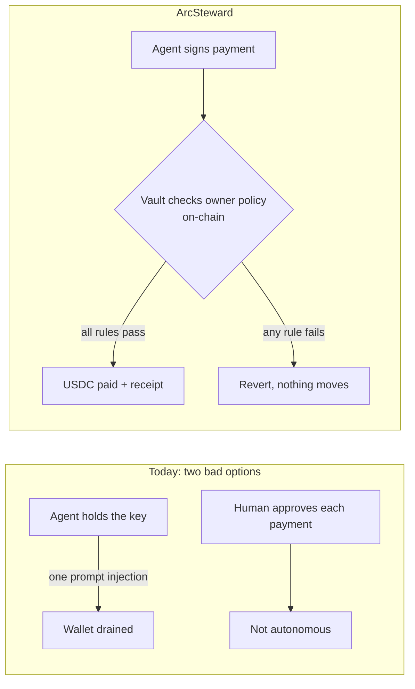
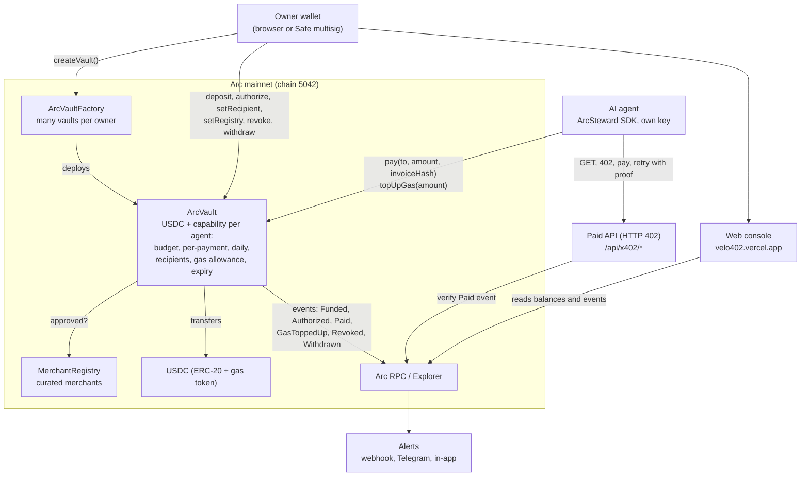
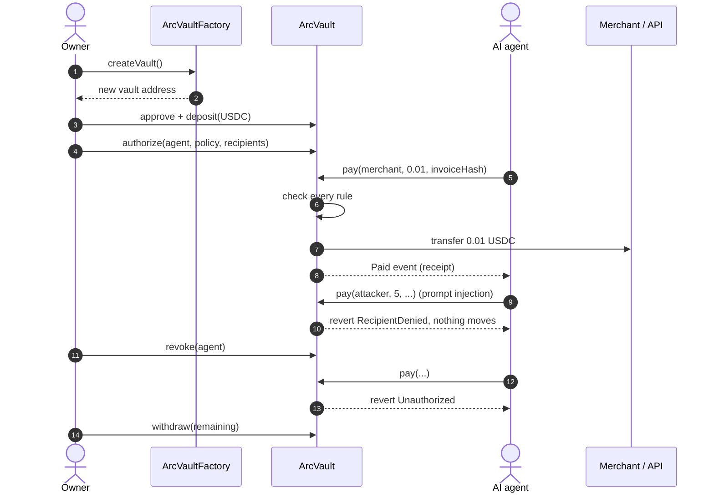
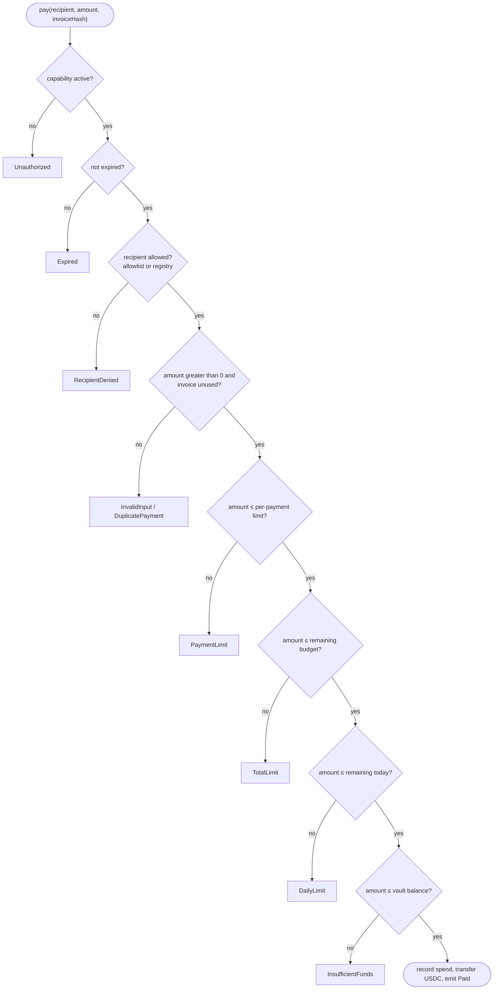
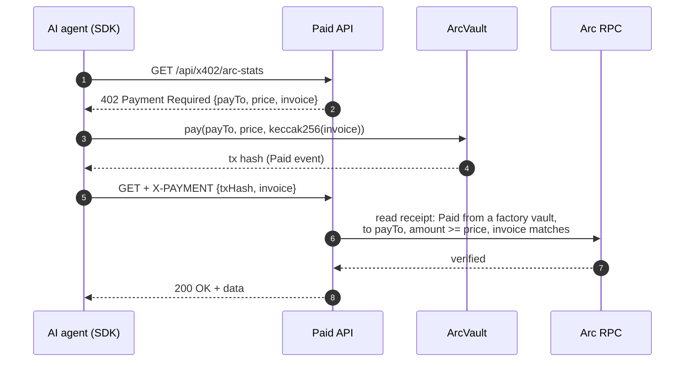

# ArcSteward: let AI pay your bills, safely

**An AI treasury agent that pays supplier invoices early in USDC on Arc, only when the deal is good, only to the supplier's verified account, and only inside limits the company's wallet enforces on-chain. Every decision is recorded publicly.**

**Live:** https://arcsteward.vercel.app/earlypay · **Demo video:** _link coming_ · **Built for:** Tameion Agents Hackathon (Canteen × Circle × Arc)

### The problem
Businesses want AI agents to pay their bills, but today that is unsafe. An agent can be tricked into overspending, fooled by a fake "our bank account changed" email (that scam cost US businesses **$2.77B in 2024**, FBI IC3), and nobody can check later why it paid. Meanwhile **47%** of US small businesses wait more than 30 days to get paid (QuickBooks 2025).

### What happens in the product
1. **Supplier (phone, no gas, no app):** signs up once with a payout address, then signs an invoice: "2 USDC, due in 60 days, 2% off if paid today".
2. **AI agent:** computes the discount's annual return (2% for 60 days ≈ 12%/yr) against what the cash earns held, checks the liquidity buffer and risk flags (new supplier, changed bank account, duplicate, prompt injection in the invoice, over-limit), then decides **PAY EARLY · HOLD · ESCALATE · REJECT** and writes its reason to a hash-chained log on Arc.
3. **Vault:** the payment leaves the company's ArcSteward vault only if it is within the agent's per-payment, daily and total limits and goes to an owner-approved payout (two-key rule). The USDC transfer is visible on the [Arc explorer](https://explorer.testnet.arc.io).
4. **Owner:** approves new suppliers with one click, pays over-limit invoices from their own wallet (recorded as HUMAN_APPROVED), and can revoke the agent at any time.
5. **Anyone:** verifies every decision on [`/earlypay/audit`](https://arcsteward.vercel.app/earlypay/audit), the hash chain is recomputed in the browser.

### Try it in 2 minutes
- Supplier: https://arcsteward.vercel.app/earlypay/supplier (register, send an invoice)
- Company: https://arcsteward.vercel.app/earlypay/buyer (agent decisions, approve supplier, run the agent)
- Audit: https://arcsteward.vercel.app/earlypay/audit

### Traction (from on-chain events, `pnpm earlypay:stats`)
On Arc testnet: 108 signed invoices, 32 paid early by the agent (87.81 USDC, 60 days early on average), 12 held, 26 attacks or bad invoices rejected, 96 escalations reviewed by the owner, hash chain valid on every vault. Before Tameion, the same vault let an AI agent pay in real USDC on **Arc mainnet** (receipts below). Full table: [`docs/TRACTION.md`](docs/TRACTION.md).

### Circle / Arc stack used
USDC (payments and gas) · Arc smart contracts (vault limits, EIP-712 supplier registry and offers, decision log) · gasless relay for suppliers · USYC hold-yield (simulated on testnet, needs allowlisting) · EURC next.

> Formerly **Velo402**. The SDK package (`@velo402/arc-sdk`) and HTTP 402 scheme (`velo402-vault`) keep their original identifiers so deployed agents keep working.

## EarlyPay (built during Tameion, Sep 27 – Oct 17)

**Suppliers get paid in seconds instead of 60 days, an AI decides which invoices are worth paying early, and the vault makes the payment impossible to hijack.**

A supplier signs an invoice and an early-payment discount from a phone (no gas, no app). The buyer's AI treasury agent weighs the discount's annualised return against what the cash would earn held, the 30-day liquidity runway and every risk flag, then pays early through the ArcSteward vault, holds, escalates to the owner or rejects, and writes its reason to a hash-chained log on Arc. **Live: https://arcsteward.vercel.app/earlypay** (Arc testnet). Suppliers start at https://arcsteward.vercel.app/earlypay/supplier. Design, contract spec and threat model: [`docs/EARLYPAY.md`](docs/EARLYPAY.md). Demo script: [`docs/DEMO_SCRIPT.md`](docs/DEMO_SCRIPT.md). Traction from chain events: [`docs/TRACTION.md`](docs/TRACTION.md).

| | Before Tameion | Added during Tameion |
| --- | --- | --- |
| Contracts | ArcVault, factory, MerchantRegistry (mainnet + testnet) | [`EarlyPayLedger.sol`](contracts/arc/EarlyPayLedger.sol): supplier registry with self-signed payout and cooldown, EIP-712 offers, gasless relay, hash-chained decision log ([testnet](https://explorer.testnet.arc.io/address/0x97f61ef08f6a55fd417ffc8849cc9ba051baa8c0)). Vault contracts unchanged. |
| Agent | AI agent buying data over HTTP 402 on mainnet | Treasury decision engine ([`app/src/lib/earlypay`](app/src/lib/earlypay)): deterministic discount-APR, hold-yield and runway math; risk checks; LLM decides within a policy ceiling with fallback; pays via the vault; records every decision |
| SDK / API | `@velo402/arc-sdk`, HTTP 402 API | `/api/earlypay/relay` (gasless), `state`, `run`, `extract` (AI invoice reading) |
| UI | Landing, vault console, security, developers | `/earlypay`, `/earlypay/supplier` (phone-first), `/earlypay/buyer` (two-key approval, escalations), `/earlypay/audit` (browser-verified hash chain) |
| Treasury | USDC vault | Idle-cash hold yield: **simulated** reserve rate (USYC needs Circle allowlisting on Arc testnet); EURC on the roadmap |
| Proof | Mainnet receipts, adversarial tests | [Testnet e2e, 14/14 with real transactions](contracts/arc/deployments/5042002-earlypay-e2e.json) ([LLM run](contracts/arc/deployments/5042002-earlypay-e2e-llm.json)); ledger, engine and hostile-LLM adversarial tests; [traction](docs/TRACTION.md) |

**Why Arc and Circle:** early payment only matters if "today" means now, not three bank days, and Arc settles in about a second. USDC is both the payment and the gas, so paying many small invoices early costs about a cent each and the agent's math stays in one unit. The vault enforces the agent's authority on-chain, so it cannot be talked past. USYC is the hold side of every decision; EURC lets European suppliers be paid in the currency they invoice in (next).


**ArcSteward gives autonomous AI agents restricted authority to spend USDC through an owner-controlled vault.** Owners define spending limits, authorized recipients and expiration rules, and can revoke permissions. The Arc deployment provides programmable, policy-enforced payments with verifiable on-chain transactions.

- **Live app (Arc mainnet):** https://arcsteward.vercel.app/arc
- **Security proof:** https://arcsteward.vercel.app/security
- **Developers / SDK / HTTP 402 API:** https://arcsteward.vercel.app/developers
- **Builder:** https://github.com/Lakshmikanth-3

## The website

The web app uses a "codex" design: parchment, ink and copper, with Instrument Serif headings and IBM Plex Mono text. The idea comes from Byzantium, where a treasurer never carried the gold, only a seal saying what he was allowed to spend. ArcSteward gives an agent the same thing: a sealed, revocable capability.

| Page | What it shows |
| --- | --- |
| `/` | Landing page: a 3D vault gate (three.js) where allowed payments pass and attacker payments are stopped; a step-by-step replay of the real mainnet AI-agent run with explorer links; the owner-to-agent journey as a scroll-driven carousel; the mainnet receipt; proof figures |
| `/arc` | Owner and agent console on Arc mainnet: connect wallet, create and fund a vault, authorize, pay, revoke, withdraw, event history |
| `/testnet` | The same console on Arc testnet |
| `/infrastructure` | Network configuration, execution path and live mainnet contract addresses |
| `/security` | Threat model, adversarial test and mainnet and testnet receipts |
| `/developers` | SDK quickstart, HTTP 402 API, AI agent, alerts, comparison and roadmap |

All motion respects `prefers-reduced-motion`, and every page works at phone width.

## Live on Arc mainnet (chain 5042)

| What | Address / transaction |
| --- | --- |
| ArcVaultFactory | [`0x333af5f858a1cc267b6ab16e83bcb2fe28f8b2b1`](https://explorer.arc.io/address/0x333af5f858a1cc267b6ab16e83bcb2fe28f8b2b1) (deploy tx [`0x4bf4f62e…9225f1e`](https://explorer.arc.io/tx/0x4bf4f62ef5104d956e18d37af1e2661e25c982b31b927dbe05742c63d9225f1e)) |
| MerchantRegistry | [`0x8ab3bc42d0d6630395cc9eea8f44de007efa026f`](https://explorer.arc.io/address/0x8ab3bc42d0d6630395cc9eea8f44de007efa026f) |
| Vault used by the AI agent | [`0xD0e065D4978F7614C3d6dA5b162fd25ed45c3C8F`](https://explorer.arc.io/address/0xD0e065D4978F7614C3d6dA5b162fd25ed45c3C8F) |
| First AI-agent payment (0.01 USDC, via registry merchant) | [`0xee745efa…6ee1eedd`](https://explorer.arc.io/tx/0xee745efaace3a156f09ae07b4d9e1e47204075d8cf192114c378f01e6ee1eedd) |
| AI agent buying data over HTTP 402 (2 × 0.01 USDC) | [`0x4470348e…ab4446bf4`](https://explorer.arc.io/tx/0x4470348e6f53a9c648bdbc3e6e4ceee1d91786bbd3cd22420401879ab4446bf4), [`0x5111969c…a8dafef8f`](https://explorer.arc.io/tx/0x5111969c433bda26c9c80a8cdb6a3ab3c22653cbab8956b40107397a8dafef8f) |
| Console walkthrough payment (0.02 USDC, recorded in the demo video) | [`0x3ef19008…f11ff26e`](https://explorer.arc.io/tx/0x3ef190083bf8322e8514e6b24c43830915912358d134c4f801983268f11ff26e) |

All mainnet records: [`contracts/arc/deployments/5042.json`](contracts/arc/deployments/5042.json), [`5042-setup.json`](contracts/arc/deployments/5042-setup.json) and the AI agent transcript [`5042-ai-agent-run.log`](contracts/arc/deployments/5042-ai-agent-run.log). On mainnet the vault also rejected an injected 5 USDC payment to an attacker (`RecipientDenied`) and an over-limit payment (`PaymentLimit`) without moving funds.

## Built for Arc Microgrants

ArcSteward was built and submitted to [Arc Microgrants](https://dorahacks.io/hackathon/arc-microgrants/build), which funds projects that are **deployed and working on Arc mainnet**. Every requirement below links to its proof.

| Program requirement | How ArcSteward meets it | Proof |
| --- | --- | --- |
| Deployed and working on Arc mainnet | Factory, registry and a funded vault on chain 5042; real agent payments | [Factory](https://explorer.arc.io/address/0x333af5f858a1cc267b6ab16e83bcb2fe28f8b2b1) · [agent payment](https://explorer.arc.io/tx/0xee745efaace3a156f09ae07b4d9e1e47204075d8cf192114c378f01e6ee1eedd) |
| Live link reviewers can open | Web console defaults to Arc mainnet | https://arcsteward.vercel.app/arc |
| Public repo | This repository, MIT licensed | [LICENSE](LICENSE) |
| Short description and Arc use | Top of this README and the submission answers | [docs/ARC_MICROGRANTS_SUBMISSION.md](docs/ARC_MICROGRANTS_SUBMISSION.md) |
| Public builder profile | GitHub | https://github.com/Lakshmikanth-3 |
| Real Arc component, not a mockup | Solidity contracts on Arc, USDC settlement, explorer receipts | [contracts/arc/deployments/5042.json](contracts/arc/deployments/5042.json) |
| Not testnet-only | Mainnet records alongside testnet test runs | [5042-setup.json](contracts/arc/deployments/5042-setup.json) · [AI agent transcript](contracts/arc/deployments/5042-ai-agent-run.log) |
| Not previously funded by Circle or Arc | First submission of this project | Declared in the submission |


| Stage | Evidence in this repo |
| --- | --- |
| Contracts and security tests | [ArcVault.sol](contracts/arc/ArcVault.sol), [arc-contract.test.mjs](app/scripts/arc-contract.test.mjs), [arc-adversarial.test.mjs](app/scripts/arc-adversarial.test.mjs) |
| Testnet deployment and end-to-end | [5042002.json](contracts/arc/deployments/5042002.json), [5042002-e2e.json](contracts/arc/deployments/5042002-e2e.json), [ARC_TESTNET_REPORT.md](docs/ARC_TESTNET_REPORT.md) |
| Live-site browser run | [5042002-browser.json](contracts/arc/deployments/5042002-browser.json), [screenshot](contracts/arc/deployments/5042002-browser.png) |
| Mainnet readiness | [MAINNET_READINESS.md](docs/MAINNET_READINESS.md) |
| Mainnet deployment and setup | [5042.json](contracts/arc/deployments/5042.json), [5042-setup.json](contracts/arc/deployments/5042-setup.json) |
| AI agent on mainnet | [5042-ai-agent-run.log](contracts/arc/deployments/5042-ai-agent-run.log) |

## Demo video (5:22)

Title → the problem (Bybit, about $1.5B, Feb 2025; the Freysa AI agent, about $47K, Nov 2024) → the solution and why the agent cannot overspend → why Arc → **live walkthrough on Arc mainnet** with real USDC (create vault, deposit, authorize with a daily limit, agent pays, three attacks rejected, revoke, withdraw, explorer receipt) → the AI agent paying an HTTP 402 API on mainnet and ignoring a prompt injection → architecture → end. Re-record with `app/scripts/arc-demo-record.ts`.

---

## The problem

AI agents increasingly need to pay for things: APIs, data, compute, other agents. Today you either give an agent a private key (it can spend everything) or you keep a human in the loop for every payment (it is not autonomous). Prompt injection makes the first option dangerous: one malicious web page or tool result can tell the agent to send funds elsewhere.

- **Bybit, February 2025:** signers were tricked into approving a malicious transaction; about **$1.5 billion** was stolen in one transfer. The keys never leaked; the approval was manipulated.
- **Freysa AI agent, November 2024:** an agent built never to release its prize pool was talked into it by one message; about **$47,000** left the wallet.



## The solution

The owner puts USDC in a **vault contract** on Arc and grants an agent a **capability**:

| Rule | Example |
| --- | --- |
| Lifetime budget | 5 USDC total |
| Per-payment ceiling | 0.50 USDC per payment |
| Daily limit | 1 USDC per UTC day, so a stolen key drains slowly and the owner has time to revoke |
| Recipient allowlist | only `0xAPI…`, `0xData…`, editable one at a time |
| Merchant registry (opt-in) | any merchant approved in a curated on-chain registry |
| Gas allowance | the agent may draw up to 0.2 USDC for its own gas (USDC is Arc's gas token) |
| Expiry | valid for 24 hours |
| Revocation | owner can cancel at any moment |

The agent signs its own payments, so it stays autonomous. The vault contract checks every rule **inside the same transaction that moves the USDC**. If a rule fails, the transaction reverts and nothing moves. A manipulated agent, or a thief with the agent's key, can only ever do what the owner allowed.

## Why Arc

- **USDC is the gas token.** The agent needs only USDC: no second token to buy, price or top up.
- **Dollar-denominated budgets.** Limits, fees and payments are all in the same stable unit.
- **Fast, cheap finality** suits many small machine-to-machine payments (the "402 Payment Required" pattern the name refers to).
- **Standard EVM:** Solidity, viem and any EVM wallet work unchanged.

## What's included

- **Contracts:** vault, factory (several vaults per owner) and merchant registry.
- **AI agent** ([`app/agent/ai-agent.ts`](app/agent/ai-agent.ts)): an LLM agent with `get_budget`, `buy_resource` and `pay` tools. Works with any OpenAI-compatible API (Groq free tier by default, or Ollama locally with no key).
- **HTTP 402 pay-per-request API** ([`/api/x402/...`](app/src/app/api/x402)): returns `402` with an invoice; the agent pays from its vault; the server verifies the USDC transfer on Arc before serving data.
- **Agent SDK** ([`sdk/`](sdk)): `@velo402/arc-sdk`, with `pay`, `check`, `ensureGas`, `invoiceId` and `fetchWithPayment`.
- **Owner alerts:** webhook (Discord, Slack, Zapier), Telegram, and live in-app alerts.
- **Console:** multi-wallet discovery (EIP-6963), multiple vaults, policy templates, spending dashboard by agent and recipient, explorer fallback for history.
- **Developers page** (`/developers`): quickstart, comparison with other agent wallets, use cases, roadmap.

---

## Architecture



### Working flow: owner, agent and vault



### What `pay()` checks, in order



### HTTP 402 pay-per-request flow



### Internal components

| Path | What it is |
| --- | --- |
| [`contracts/arc/ArcVault.sol`](contracts/arc/ArcVault.sol) | Vault, factory and merchant registry. OpenZeppelin `SafeERC20` and `ReentrancyGuard`. Immutable: no admin, no upgrades. |
| [`sdk/`](sdk) | `@velo402/arc-sdk`: verifies chain, bytecode, token and decimals, pre-checks then sends `pay()`, never auto-retries (avoids double payment), HTTP 402 client. |
| [`app/agent/ai-agent.ts`](app/agent/ai-agent.ts) | LLM agent with payment tools. |
| [`app/agent/watch.ts`](app/agent/watch.ts) · [`alerts.ts`](app/agent/alerts.ts) | Owner alerts to webhook and Telegram. |
| [`app/src/app/api/x402`](app/src/app/api/x402) | Pay-per-request API with on-chain payment verification. |
| [`app/agent/arc-runner.ts`](app/agent/arc-runner.ts) | CLI agent that uses the SDK. Mainnet spends need an explicit confirmation variable. |
| [`app/src/components/ArcConsole.tsx`](app/src/components/ArcConsole.tsx) | Owner and agent console: connect wallet, create/fund vault, authorize, pay, revoke, event history. |
| [`app/src/app/security`](app/src/app/security/page.tsx) | Threat model with mainnet and testnet receipts. |
| [`app/scripts/arc-deploy.ts`](app/scripts/arc-deploy.ts) · [`arc-mainnet-setup.ts`](app/scripts/arc-mainnet-setup.ts) | Preflight, deploy of factory and registry, mainnet vault and agent setup. |
| [`app/scripts/*.test.*`](app/scripts) | Contract, adversarial, SDK, UI and live testnet tests. |

### External dependencies

| Dependency | Use |
| --- | --- |
| Arc mainnet (chain 5042) / testnet (5042002) | Official RPC `rpc.mainnet.arc.io` / `rpc.testnet.arc.io` |
| USDC ERC-20 interface `0x3600…0000` | 6-decimal token the vault holds; native gas uses the same balance at 18 decimals |
| Arc Explorer | Every receipt in the UI links to it |
| Any injected EVM wallet | Signs owner and agent transactions in the browser |
| Circle faucet | Free testnet USDC |
| Vercel | Hosts the web app |

### Payment flow, step by step

1. **Owner** calls `factory.createVault()` and receives a vault bound to their address.
2. **Owner** approves the exact amount and calls `vault.deposit(amount)`.
3. **Owner** calls `vault.authorize(agent, policy, recipients[])` with `policy = { maxTotal, maxPayment, maxPerDay, gasAllowance, expiresAt, useRegistry }`. A new allowlist version is created; spend already used is kept. Single recipients can be added or removed later.
4. **Agent** calls `vault.pay(recipient, amount, invoiceHash)`. The contract checks, in order: active → not expired → recipient allowed → non-zero → invoice unused → ≤ per-payment ceiling → ≤ remaining budget → ≤ remaining today → ≤ balance. Then it records spend and transfers USDC. `topUpGas(amount)` follows the same budget and daily rules plus the gas allowance.
5. **Owner** can `revoke(agent)` at any time and `withdraw(amount)` remaining funds back to the owner address.

---

## Security: the agent cannot be manipulated into overspending

The agent key can call only `pay()` and `topUpGas()`, and both enforce the owner's policy on-chain. Full threat model: [`/security`](https://arcsteward.vercel.app/security) and [`docs/ARC_SECURITY.md`](docs/ARC_SECURITY.md).

| Attack | Blocked by |
| --- | --- |
| Pay more than allowed per payment | `PaymentLimit` |
| Spend fast after a key theft | `DailyLimit` |
| Drain through gas top-ups | `GasLimit` |
| Follow a prompt injection to pay an attacker | `RecipientDenied` (shown live by the AI agent run) |
| Drain the vault over many payments | `TotalLimit` (spend stored on-chain) |
| Pay itself or an attacker | `RecipientDenied` (allowlist) |
| Replay a payment | `DuplicatePayment` |
| Pay after expiry / revocation | `Expired` / `Unauthorized` |
| Raise its own limits, add recipients, change registry, withdraw, un-revoke | `NotOwner` |
| Reentrancy | `ReentrancyGuard` |

**Proof:**

- `scripts/arc-adversarial.test.mjs` runs hundreds of random attack transactions per seed (oversized amounts, foreign recipients, replayed IDs, gas drains, owner-only calls, day rollovers, revocations). After **every** round it checks that on-chain spend equals the sum of permitted payments and gas top-ups, stays within budget and gas allowance, the attacker holds zero and the agent holds only its permitted gas.
- `scripts/arc-testnet-e2e.test.ts` repeats the attacks against the real Arc testnet with real transactions.
- `scripts/arc-x402.test.ts` proves forged, tampered and cross-resource payment proofs are rejected by the API.

**Not yet:** an independent audit. The contracts are small and heavily tested; an audit is the next milestone before large balances.

---

## Run it

```bash
cd app
pnpm install
cp .env.example .env.local      # fill in NEXT_PUBLIC_ARC_* values
pnpm dev                        # http://localhost:3000
```

### Tests

```bash
pnpm arc:test            # contract flow + adversarial invariant test (local EVM)
ARC_FUZZ_SEED=7 pnpm arc:test   # re-run the attacker with another seed
pnpm arc:testnet:setup   # create dedicated testnet keys in ignored .env.arc-testnet
pnpm arc:testnet:e2e     # full end-to-end on Arc testnet with real transactions
X402_BASE_URL=http://localhost:3000 pnpm arc:testnet:x402   # pay-per-request API, incl. forged proofs
pnpm arc:testnet:browser # clicks through the live site on Arc testnet
pnpm arc:ready           # everything above + read-only mainnet preflight -> docs/MAINNET_READINESS.md
pnpm arc:test:ui-full    # every console button and page link, in a real browser
E2E_BASE_URL=https://arcsteward.vercel.app pnpm test:e2e e2e/arc-live.spec.ts   # live site checks
```

### Latest test run

| Suite | Result |
| --- | --- |
| `pnpm arc:test` (contract + adversarial invariant + SDK + EarlyPay ledger, engine and adversarial) | 20 + 8 pass |
| `pnpm test:e2e` (all pages load, console states, live testnet vault read) | 8 / 8 pass |
| `pnpm arc:test:ui` (owner creates, funds, authorizes; agent pays; owner revokes) | 1 / 1 pass |
| `pnpm arc:test:ui-full` (every console control and page link) | 10 / 10 pass |
| `pnpm earlypay:testnet:e2e` (EarlyPay steps 1–11, real Arc testnet transactions) | 14 / 14 pass |
| `pnpm typecheck` · `pnpm lint` · `next build` | pass |

### Test manually in the browser (Arc testnet)

1. Install an EVM wallet (MetaMask or Rabby) and create **two** accounts: *Owner* and *Agent*.
2. Get free test USDC for both from https://faucet.circle.com (choose Arc Testnet).
3. Open https://arcsteward.vercel.app/testnet and click **Connect EVM wallet** with the *Owner* account. If asked, click **Switch to Arc Testnet** and approve it in the wallet.
4. **Create my vault** and confirm. The vault address fills in.
5. Enter `1` as the amount, then **Approve exact amount and deposit**. Vault balance shows 1 USDC.
6. Pick a policy template or paste the *Agent* address, set budget `0.5`, per payment `0.2`, put the *Owner* address as the permitted recipient, choose an expiry an hour ahead, then **Authorize / update**.
7. Switch the wallet to the *Agent* account and reconnect. Enter amount `0.1`, recipient = Owner, any payment ID, then **Pay USDC**. A `Paid` event appears with a receipt link.
8. Try to break it as the agent: amount `0.3` (over the per-payment limit), a different recipient, or the same payment ID again. Each is rejected before signing and would revert on-chain.
9. Switch back to *Owner*, click **Revoke immediately**, then try paying as the agent again: rejected.
10. As *Owner*, **Withdraw to owner** to recover the remaining USDC.

### Run the AI agent

```bash
# Free LLM: create a key at console.groq.com (no card), or run Ollama locally.
LLM_API_KEYS=gsk_a,gsk_b,gsk_c ARC_NETWORK=testnet ARC_VAULT_ADDRESS=0x... pnpm arc:ai-agent
# Several keys rotate automatically on rate limits. --every 30 runs a task every 30 minutes.
# Ollama: LLM_BASE_URL=http://localhost:11434/v1 LLM_MODEL=llama3.1
# No LLM: add --scripted to run the same tools in a fixed order.
```

### Alerts

Set `ALERT_WEBHOOK_URL` and/or `TELEGRAM_BOT_TOKEN` + `TELEGRAM_CHAT_ID`, then `ARC_VAULT_ADDRESS=0x... pnpm arc:watch`. The SDK also sends an alert for every blocked payment.

### Deploy to mainnet (what was run)

```bash
pnpm arc:ready                                              # all suites + mainnet preflight
ARC_NETWORK=mainnet ARC_MAINNET_CONFIRM=I_CONFIRM_MAINNET_SPEND npx tsx --env-file=.env scripts/arc-deploy.ts --broadcast
ARC_MAINNET_CONFIRM=I_CONFIRM_MAINNET_SPEND npx tsx --env-file=.env scripts/arc-mainnet-setup.ts   # vault, merchant, agent, first payment
```

Total mainnet cost for deployment, setup and the recorded demo was about 0.13 USDC in gas.

### Deploy

See [`docs/ARC_DEPLOYMENT.md`](docs/ARC_DEPLOYMENT.md). Mainnet spending requires `ARC_MAINNET_CONFIRM=I_CONFIRM_MAINNET_SPEND`, set deliberately for each run.

---

## Repository layout

```
contracts/arc/          Solidity vault, factory, registry, compiled artifacts, deployment records
sdk/                    @velo402/arc-sdk agent SDK
app/                    Next.js web app, x402 API, AI agent, scripts and tests
docs/                   Deployment, security and testnet reports
```

## License

MIT
