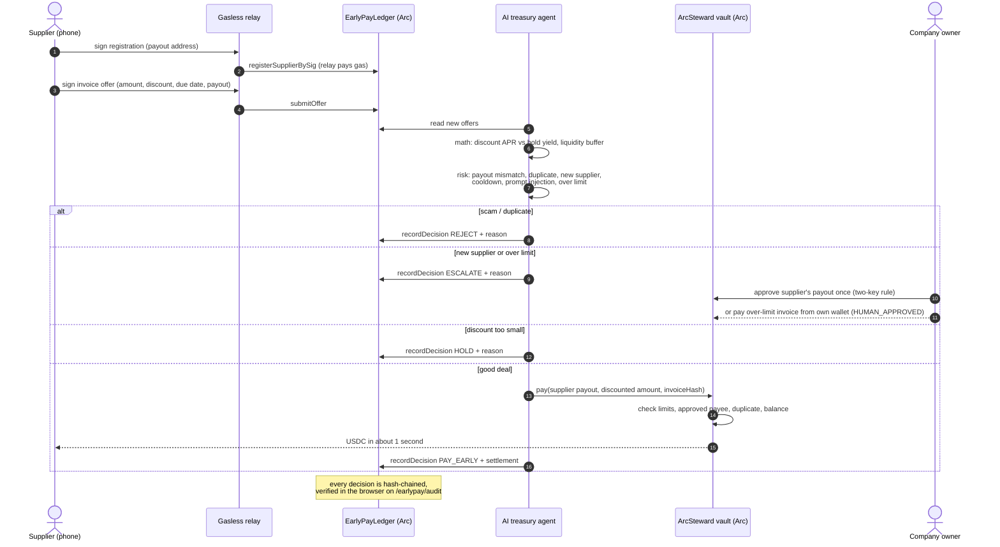
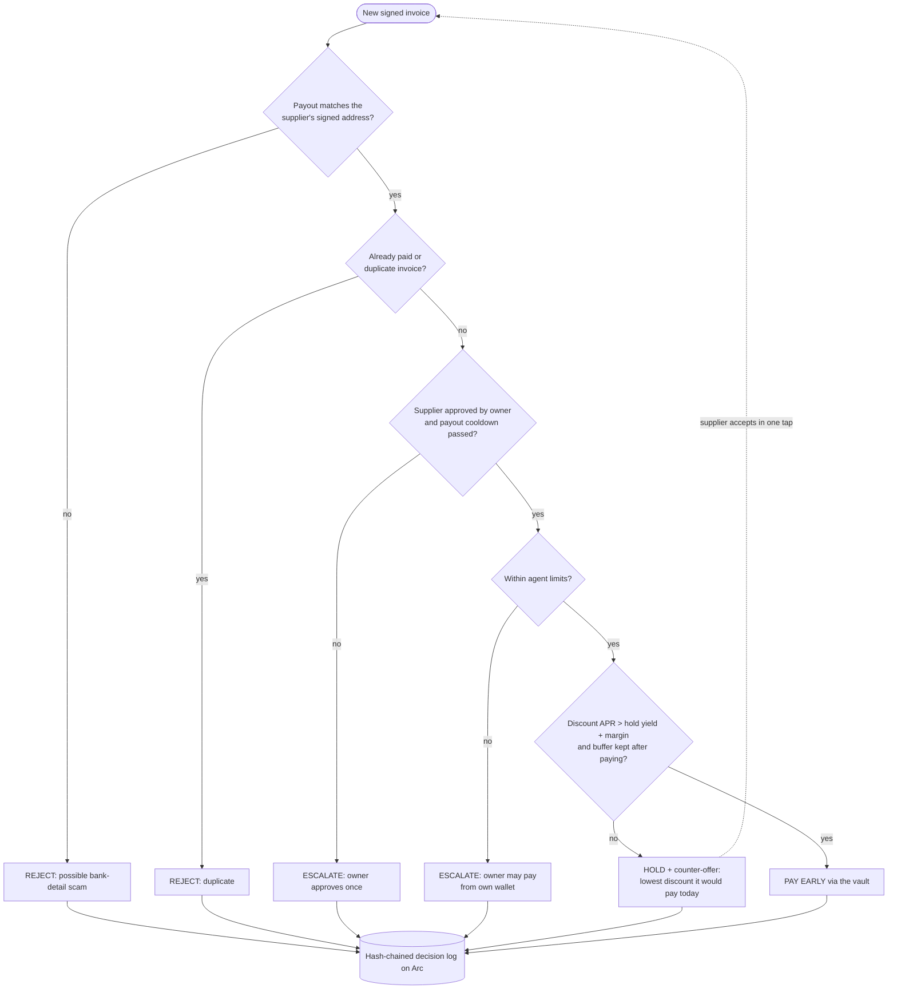
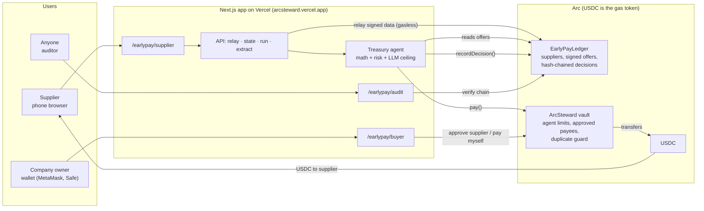
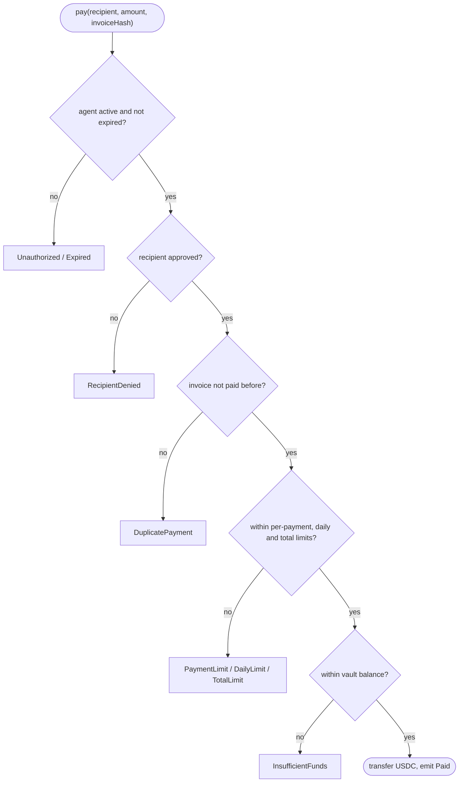

# ArcSteward: the payables agent that makes money, not just pays bills

**ArcSteward's agent reads supplier early-payment offers and decides, invoice by invoice, whether paying early earns more than holding the cash.** 2% for 60 days early is about 12% a year; idle cash earns about 4.5%. When the deal is good it pays in seconds in USDC on Arc. When it isn't, it holds and **makes a counter-offer** ("offer 1.07% and I pay today"), which the supplier accepts in one tap.

**Discount captured so far:** 32+ invoices paid early by the agent on Arc testnet, about 60 days early on average, every discount kept by the buyer (from on-chain events, `pnpm earlypay:stats`).

Safety is what lets it act alone: suppliers sign their own payout address, the vault enforces the agent's limits on-chain, and every decision is hash-chained on Arc.

| | |
| --- | --- |
| **Live app** | https://arcsteward.vercel.app/earlypay (Arc testnet) |
| **Demo video** | _link coming_ |
| **Supplier page** (phone) | https://arcsteward.vercel.app/earlypay/supplier |
| **Company page** | https://arcsteward.vercel.app/earlypay/buyer |
| **Public audit** | https://arcsteward.vercel.app/earlypay/audit |
| **Built for** | Tameion Agents Hackathon (Canteen × Circle × Arc) |

---

## The problem

Businesses want AI agents to pay their bills, but today that is unsafe:

- **It can overspend.** One mistake or one prompt injection and nothing stops the agent.
- **It can be fooled.** Fake "our bank account changed" emails (business email compromise) cost US businesses **$2.77 billion in 2024** (FBI IC3). A program is easier to fool than a person.
- **Nobody can check it.** There is no record of why the agent paid what it paid.

On the other side, **47% of US small businesses** are owed money more than 30 days late (QuickBooks 2025). A supplier will happily give 2% off to be paid today, and for the company paying, 2% for 60 days early is about 12% a year, far more than idle cash earns.

## The solution

ArcSteward EarlyPay lets an AI agent capture those discounts without ever being able to lose the company's money:

1. **The company's USDC sits in an ArcSteward vault on Arc.** The agent gets a capability: per-payment, daily and total limits, an expiry, and payment only to approved suppliers. The vault contract checks every rule inside the transaction that moves the money.
2. **Suppliers sign their own payout address and invoices** (EIP-712) from a phone. No app, no gas: a relay pays the network fee.
3. **The agent decides** PAY EARLY, HOLD (with a counter-offer), ESCALATE or REJECT, using deterministic math (discount APR vs. hold yield, liquidity buffer) plus risk checks, with an LLM choosing only within the ceiling the math and policy allow.
4. **Every decision is written to a hash-chained log on Arc**, with the numbers the agent saw and its reason. Anyone can verify the chain in the browser.

---

## Working flow



### How the agent decides



The LLM (`gpt-oss-120b` via Groq, with fallback) may only pick a decision **at or below** the ceiling set by the math and the policy. For example it can turn PAY_EARLY into HOLD, but it can never turn ESCALATE or REJECT into a payment. Text inside an invoice is treated as data, never as instructions.

---

## Architecture



| Component | Where |
| --- | --- |
| EarlyPayLedger (supplier registry with self-signed payout and cooldown, EIP-712 offers, hash-chained decision log) | [`contracts/arc/EarlyPayLedger.sol`](contracts/arc/EarlyPayLedger.sol), testnet [`0x97f6…a8c0`](https://explorer.testnet.arc.io/address/0x97f61ef08f6a55fd417ffc8849cc9ba051baa8c0) |
| ArcSteward vault, factory and merchant registry (agent capability, on-chain limits) | [`contracts/arc/ArcVault.sol`](contracts/arc/ArcVault.sol) |
| Decision engine: math, risk checks, LLM within a ceiling, decision log encoding | [`app/src/lib/earlypay`](app/src/lib/earlypay) |
| API: gasless relay, state, run the agent, AI invoice reading | [`app/src/app/api/earlypay`](app/src/app/api/earlypay) |
| Pages: landing, supplier, buyer, audit | [`app/src/app/earlypay`](app/src/app/earlypay) |
| Vault console (create, fund, set limits, revoke) | `/arc` (mainnet), `/testnet` |
| Agent SDK and HTTP 402 pay-per-request API | [`sdk/`](sdk), [`app/src/app/api/x402`](app/src/app/api/x402) |

### What the vault checks on every `pay()`



If any rule fails the transaction reverts and nothing moves, so a tricked agent, or a thief holding the agent's key, can only ever do what the owner allowed.

---

## Traction (from on-chain events)

Generated by `pnpm earlypay:stats` from Arc events only, nothing self-reported. Full table: [`docs/TRACTION.md`](docs/TRACTION.md).

| Metric (Arc testnet) | Value |
| --- | --- |
| Signed invoices | 108+ |
| Paid early by the agent | 32+ (87.8+ USDC, 60 days early on average) |
| Held (discount below hurdle) | 12+ |
| Attacks and bad invoices refused | 26+ |
| Escalations reviewed by the owner | 96+ |
| Vaults with a valid decision hash chain | all |

The same vault design already lets an AI agent pay in real USDC on **Arc mainnet** (factory [`0x333a…b2b1`](https://explorer.arc.io/address/0x333af5f858a1cc267b6ab16e83bcb2fe28f8b2b1), first agent payment [`0xee74…eedd`](https://explorer.arc.io/tx/0xee745efaace3a156f09ae07b4d9e1e47204075d8cf192114c378f01e6ee1eedd)), where it also rejected an injected payment to an attacker.

## Circle and Arc stack

| Tool | How it is used |
| --- | --- |
| **USDC** | Every payment, and the gas token, so the agent's math stays in one unit |
| **Arc smart contracts** | Vault limits, supplier registry, signed offers, decision log |
| **Gasless relay** | Suppliers never hold gas; the relay submits their signed data |
| **USYC** | The hold side of every decision (hold yield). **Simulated** on testnet, since USYC needs Circle allowlisting |
| **EURC** | Next: pay European suppliers in the currency they invoice in |

**Why Arc:** paying early only matters if "today" means now. Arc settles in under a second for less than a cent in USDC, so an agent can pay many small invoices early and still come out ahead.

---

## Security

| Attack | Blocked by |
| --- | --- |
| "Our bank account changed" invoice | payout must match the supplier's own signed address → REJECT |
| Changing the payout and getting paid at once | payout cooldown + owner approval (two-key rule) |
| Paying the same invoice twice | ledger duplicate check + vault `DuplicatePayment` |
| Hidden instructions in an invoice | invoice text is data; the LLM cannot exceed the decision ceiling |
| Overspending | vault per-payment, daily and total limits |
| Paying anyone else | vault `RecipientDenied` |
| Editing the record | hash-chained log, recomputed in the browser |
| A stolen agent key | limits + owner can revoke instantly |

Tests: [`earlypay-adversarial.test.ts`](app/scripts/earlypay-adversarial.test.ts) runs a hostile LLM against the engine and shows no USDC ever reaches an unapproved address; [`arc-adversarial.test.mjs`](app/scripts/arc-adversarial.test.mjs) fires hundreds of random attack transactions at the vault. Threat model: [`docs/EARLYPAY.md`](docs/EARLYPAY.md).

---

## Run it

```bash
cd app
pnpm install
cp .env.example .env.local      # fill in NEXT_PUBLIC_ARC_* and EarlyPay values
pnpm dev                        # http://localhost:3000/earlypay
```

### Tests

```bash
pnpm earlypay:test          # ledger, decision engine, hostile-LLM adversarial
pnpm arc:test               # vault contracts + adversarial invariant + SDK + EarlyPay
pnpm earlypay:testnet:e2e   # full flow on Arc testnet with real transactions (14 steps)
pnpm earlypay:live:browser  # real browser on the live site: supplier → agent → owner → audit
pnpm test:e2e               # Playwright page checks
pnpm earlypay:stats         # traction numbers from chain events
```

| Suite | Latest result |
| --- | --- |
| `arc:test` | 20 + 8 pass |
| `earlypay:test` | 8 + 6 pass |
| `earlypay:testnet:e2e` | 14 / 14 pass |
| `earlypay:live:browser` | all steps pass |
| Playwright (local and live) | 8 / 8 pass |

### Try it by hand (Arc testnet)

1. Get test USDC from https://faucet.circle.com (Arc Testnet).
2. On a phone, open `/earlypay/supplier`, register, and send an invoice with a 2% discount.
3. On `/earlypay/buyer`, connect the vault owner wallet, click **Run the agent now**: a new supplier is escalated.
4. Click **Approve supplier**, run the agent again: the invoice is paid early. Open **payment ↗** to see the USDC transfer on the Arc explorer.
5. Try a 0.5% discount (HOLD), an invoice over 5 USDC (ESCALATE, then **Approve & pay myself**), and the same invoice number twice (REJECT).
6. Open `/earlypay/audit`: every decision with its reason, hash chain verified in the browser.

---

## Repository layout

```
contracts/arc/          EarlyPayLedger, ArcSteward vault, factory, registry, deployment records
app/src/lib/earlypay/   decision engine, risk checks, chain reading, decision log
app/src/app/earlypay/   supplier, buyer and audit pages
app/src/app/api/        EarlyPay relay/state/run/extract API, HTTP 402 API
app/scripts/            deploy, tests, stats, demo video recorder
sdk/                    agent SDK
docs/                   EarlyPay design, traction, submission
```

> Formerly **Velo402**. The SDK package (`@velo402/arc-sdk`) and HTTP 402 scheme (`velo402-vault`) keep their original identifiers so deployed agents keep working.

## License

MIT
